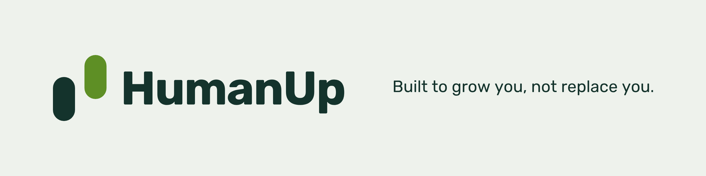

  

  

## What is HumanUp
 
HumanUp is an open-source AI brand. We'll keep releasing products and AI assets, in whatever form fits. They all share one position: AI should make you stronger, not take your place.

## What we believe

**Open.** Everything we make is open source. Anyone can use it and change it, so the means of growing people don't belong to a few.

**People lead.** You decide, you do the work, and you own the outcome. AI belongs beside you, not in your place.

**Growth is the measure.** Whether something belongs to HumanUp comes down to one question: are you stronger for having used it?

**Honest about AI.** No myths about AI, and no underestimating you. We don't sell fear, and we don't promise miracles.

---

<b>Built to grow you, not replace you.</b>

